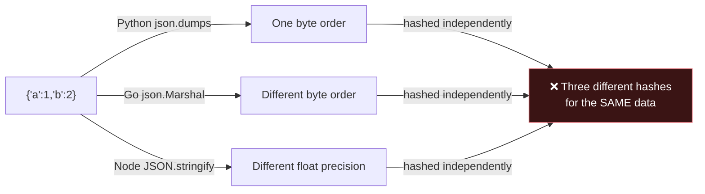
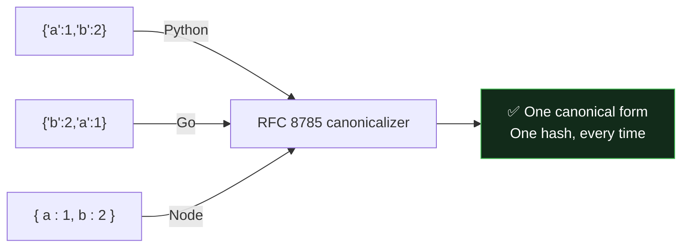
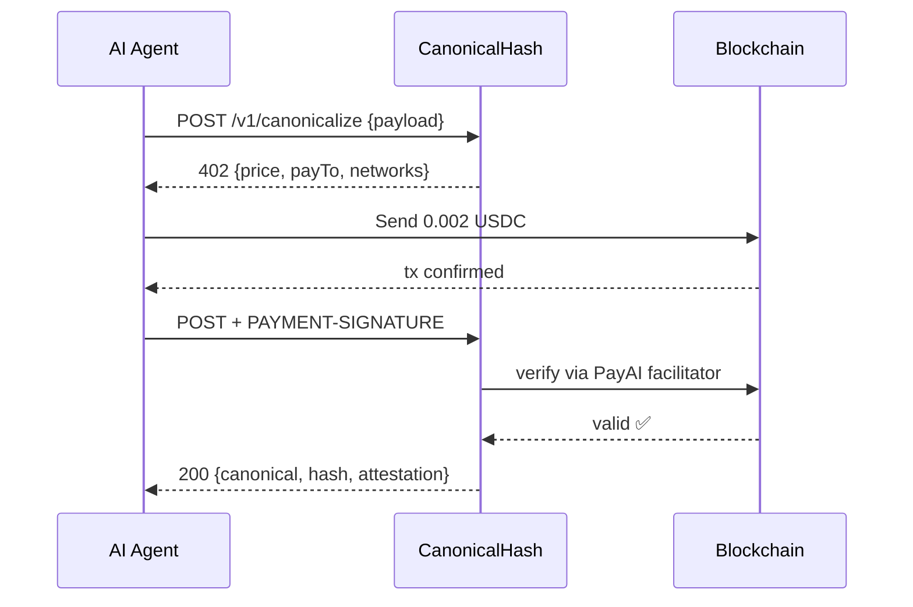

# 🔐 CanonicalHash

**RFC 8785 JSON Canonicalization + EIP-712 attestation for AI agents.** Deterministic hash of any JSON payload — byte-for-byte identical across sessions, languages, and runtimes.

[](https://payapi.market/api/canonicalhash-json-canonicalization-api)
[](https://x402.org)
[](https://www.rfc-editor.org/rfc/rfc8785)
[](https://eips.ethereum.org/EIPS/eip-712)
[](https://base.org)
[](https://solana.com)
[](#license)
[](https://github.com/mlartab/canonicalhash-api)

[The Problem](#-what-this-solves) · [Quick Call](#-quick-call) · [Why Pay For This](#-why-agents-pay-for-this) · [Endpoints](#-endpoints) · [Attestation](#-attestation-format) · [Verify](#-how-to-verify)

---

## 🔗 Live Endpoint

```
https://canonicalhash-production.up.railway.app/v1/canonicalize
```

|  |  |
| --- | --- |
| **Price** | `$0.002 USDC` per call · `$0.01` for batch (up to 1000 items) |
| **Protocol** | x402 v2 · Base (`eip155:8453`) or Solana |
| **Latency** | \<50ms (Tier 1) / \~2s (Tier 2 with attestation) |

---

## ❗ What This Solves

JSON is **not** deterministic across runtimes:



This breaks real systems:

| Breaks | How |
| --- | --- |
| 🔑 **Idempotency keys** for payments | Duplicate requests slip through |
| 🗄️ **Cache keys** | Identical payloads miss the cache |
| 🔁 **Cross-runtime deduplication** | Python and Go disagree on the hash |
| 🤝 **Multi-agent coordination** | Agent A and B can't verify they mean the same data |
| 📋 **Audit trails** | No way to prove what was hashed, or when |

**CanonicalHash fixes this** by returning the RFC 8785 canonical bytes and a stable SHA-256/512 digest — plus an EIP-712 signed attestation.



---

## 🚀 Quick Call

```bash
# 1. Call unpaid — receive a 402 challenge
curl -X POST https://canonicalhash-production.up.railway.app/v1/canonicalize \
  -H 'Content-Type: application/json' \
  -d '{"payload": {"b": 2, "a": 1}, "algorithm": "sha256"}'

# 2. Pay the challenge, retry with PAYMENT-SIGNATURE header
curl -X POST https://canonicalhash-production.up.railway.app/v1/canonicalize \
  -H 'Content-Type: application/json' \
  -H 'PAYMENT-SIGNATURE: <your-signed-payment>' \
  -d '{"payload": {"b": 2, "a": 1}, "algorithm": "sha256"}'
```

**Response:**

```json
{
  "success": true,
  "canonical": "{\"a\":1,\"b\":2}",
  "hash": "43258cff783fe7036d8a43033f830adfc60ec037382473548ac742b888292777",
  "algorithm": "sha256",
  "spec": "RFC 8785",
  "stats": { "inputBytes": 13, "canonicalBytes": 13 },
  "payment": {
    "settled": true,
    "txHash": "0x78c4904db8263fd8ceac4d715a824ff7b9c087d69a9f8e15f7918280c6e3157a"
  },
  "attestation": {
    "signer": "0x0326f9783c9C9b9De8b9dC63cCCefDC75A95C7cD",
    "signed_hash": "43258cff783fe703...",
    "hash_alg": "sha256",
    "issued_at": "2026-10-14T12:00:00.000Z",
    "issued_at_unix": 1791987600,
    "scheme": "EIP-712",
    "signature": "0x...",
    "verify_at": "https://canonicalhash-production.up.railway.app/.well-known/pubkey.json"
  }
}
```

**Call sequence:**



---

## 🧠 Why Agents Pay For This

A capable LLM can canonicalize JSON locally. So why pay `$0.002` per call?

> **Because the moat is not the hash — it's the receipt.**

The `attestation` field is an **EIP-712 signature** over the hash + timestamp, signed by a stable address you can verify against a published public key. This makes CanonicalHash a **trust primitive**, not a utility.

| Use case | Why local computation fails |
| --- | --- |
| 🏢 **Cross-org agent handoffs** | Agent A gives data to Agent B. B needs proof the data came from A, not a compromised middleman. |
| ⚖️ **Dispute resolution** | Two agents disagree about what was agreed. An independent timestamped hash settles it. |
| 🔎 **Regulatory audit** | An auditor wants proof a specific payload existed at a specific time — signed by a third party, not the agent's own key. |
| 🤖 **Multi-agent coordination** | Multiple agents in different orgs need the *same* hash for the *same* payload. |

The **IETF SCITT** standard explicitly requires attestations be held by "a party other than the agent's operator." **That's the gap CanonicalHash fills.**

---

## 📡 Endpoints

### Paid routes

| Route | Method | Price | Purpose |
|---|---|---|---|
| `/v1/canonicalize` | POST / GET / HEAD / DELETE | $0.002 | Canonicalize one payload + EIP-712 attestation |
| `/v1/canonicalize/batch` | POST | $0.01 | Up to 1000 payloads, one attestation |
| `/v1/structure/paid` | POST / GET / HEAD / DELETE | $0.005 | Extract structured JSON from messy text |
| `/v1/verify` | POST | free | Verify any attestation (EIP-712 signature check) |

### Admin route (token-gated)

| Route | Method | Auth | Purpose |
|---|---|---|---|
| `/v1/structure` | POST | `x-admin-token` header | Same extraction, no payment. Returns 404 without a valid token. |

### Discovery routes (free)

| Route | Purpose |
|---|---|
| `/health` | Uptime check |
| `/metrics` | Prometheus metrics |
| `/openapi.json` | OpenAPI 3.1.0 spec |
| `/llms.txt` | Agent-readable service manifest (markdown) |
| `/agents.json` | Structured agent index (aliases `/.well-known/agent.json`) |
| `/.well-known/x402.json` | x402 discovery document |
| `/.well-known/x402` | Alias (no `.json` extension) for x402 crawlers |
| `/.well-known/pubkey.json` | EIP-712 signer address + verify instructions |
| `/v1/verify` | Free attestation verifier (EIP-712 signature recovery) |
| `/.well-known/agent.json` | Structured agent manifest |

---

## 📨 Request (single)

```
POST /v1/canonicalize
Content-Type: application/json
```

```json
{
  "payload": { "b": 2, "a": 1 },
  "algorithm": "sha256"
}
```

| Field | Type | Required | Description |
| --- | --- | --- | --- |
| `payload` | any | ✅ | The JSON value to canonicalize |
| `algorithm` | string | — | `"sha256"` (default) or `"sha512"` |

**Constraints**

- `payload` must be valid JSON (any value: object, array, string, number, boolean, null)
- `NaN` and `Infinity` are rejected
- Unicode is preserved as-is (RFC 8785 does not normalize)

---

## 📦 Request (batch)

```
POST /v1/canonicalize/batch
Content-Type: application/json
```

```json
{
  "payloads": [
    { "user_id": 1, "amount": 10 },
    { "user_id": 2, "amount": 20 }
  ],
  "algorithm": "sha256"
}
```

Up to **1000 payloads** per call for a **flat `$0.01`** (`$0.00001` per item).

**Batch response:**

```json
{
  "success": true,
  "count": 2,
  "algorithm": "sha256",
  "results": [
    { "index": 0, "canonical": "...", "hash": "..." },
    { "index": 1, "canonical": "...", "hash": "..." }
  ],
  "combined_hash": "...",
  "attestation": { "...": "..." },
  "payment": { "settled": true, "txHash": "0x..." }
}
```

---

Structure extraction (V5)
POST /v1/structure/paid — extract structured JSON from messy text.

    POST /v1/structure/paid
    Content-Type: application/json

    {
      "text": "Contact: Alice Smith, alice@example.com, ACME Corp, $1,250.00 due on 2026-11-01",
      "schema": {
        "type": "object",
        "properties": {
          "name": {"type": "string"},
          "email": {"type": "string"},
          "company": {"type": "string"},
          "amount": {"type": "number"},
          "due_date": {"type": "string"}
        }
      }
    }

Two extraction tiers:

| Tier | Method | Latency | When |
|------|--------|---------|------|
| 1 | Deterministic regex | <50ms | Labeled inputs (Contact:, Amount:, Due:) |
| 2 | Needle 3 model | ~2s | Free-form text without labels |

The response includes a `tier` field (1 or 2) so you know which path was used. If
extraction fails, you are not charged — the payment signature expires unused after 60 seconds.

Response:

    {
      "success": true,
      "structured": {
        "name": "Alice Smith",
        "email": "alice@example.com",
        "company": "ACME Corp",
        "amount": 1250,
        "due_date": "2026-11-01"
      },
      "tier": 1,
      "method": "deterministic",
      "confidence": 0.98,
      "attestation": { ... },
      "payment": { "settled": true, "txHash": "0x..." }
    }

Use when an agent needs to turn emails, logs, tickets, or notes into structured fields — without writing a prompt or paying a separate LLM.

---

## 🖋️ Attestation Format

Every successful single, batch, or structure response includes an EIP-712 signed attestation.

```json
{
  "issuer": "canonicalhash-production.up.railway.app",
  "signer": "0x0326f9783c9C9b9De8b9dC63cCCefDC75A95C7cD",
  "signed_hash": "43258cff783fe703...",
  "hash_alg": "sha256",
  "issued_at": "2026-10-14T12:00:00.000Z",
  "issued_at_unix": 1791987600,
  "scheme": "EIP-712",
  "schema_version": 1,
  "domain": { "name": "CanonicalHash", "version": "1.0.0", "chainId": 8453 },
  "signature": "0x...",
  "verify_at": "https://canonicalhash-production.up.railway.app/.well-known/pubkey.json"
}
```

The signature is over `{ hash, algorithm, issuedAt }`. Any standard EIP-712 verifier can recover the signer — this has been verified with both **viem** and **ethers**.

---

## ✅ How to Verify

```javascript
import { recoverTypedDataAddress } from "viem"

const recovered = await recoverTypedDataAddress({
  domain: attestation.domain,
  types: {
    Attestation: [
      { name: "hash", type: "string" },
      { name: "algorithm", type: "string" },
      { name: "issuedAt", type: "uint256" },
    ],
  },
  primaryType: "Attestation",
  message: {
    hash: attestation.signed_hash,
    algorithm: attestation.hash_alg,
    issuedAt: BigInt(attestation.issued_at_unix),
  },
  signature: attestation.signature,
})

// recovered === attestation.signer === pubkey.address
```

The signing address is published at `/.well-known/pubkey.json`.

---

## 🌐 Verify with an HTTP call

Don't want to install viem? The service exposes a **free, unauthenticated verifier endpoint** that does the same check server-side.

```bash
curl -X POST https://canonicalhash-production.up.railway.app/v1/verify \
  -H 'Content-Type: application/json' \
  -d @your-paid-response.json
```

Response:

```json
{
  "valid": true,
  "signer": "0x0326f9783c9C9b9De8b9dC63cCCefDC75A95C7cD",
  "expected_signer": "0x0326f9783c9C9b9De8b9dC63cCCefDC75A95C7cD",
  "attestation_hash": "60196f74f027a2b2a0c2eb1143dd6cc1a2319c87479a846ed0d140e4bc2403e7",
  "hash_alg": "sha256",
  "issued_at_unix": 1792185673,
  "issuer": "canonicalhash-production.up.railway.app",
  "scheme": "EIP-712"
}
```

You can send either the full paid response or just the `attestation` object. Invalid signatures return `{"valid": false, ...}` -- never a 5xx. Rate limited at 300/min per IP.

---

## 🔍 Discovery

| Interface | URL |
| --- | --- |
| OpenAPI | `https://canonicalhash-production.up.railway.app/openapi.json` |
| x402 well-known | `https://canonicalhash-production.up.railway.app/.well-known/x402.json` |
| llms.txt | `https://canonicalhash-production.up.railway.app/llms.txt` |
| Signer pubkey | `https://canonicalhash-production.up.railway.app/.well-known/pubkey.json` |

### 🧠 Native MCP Server

CanonicalHash is an official Model Context Protocol (MCP) server. AI agents using Claude Desktop, Cursor, or Windsurf can autonomously call our tools and pay per request.

Paste this into your MCP client configuration:

```json
{
  "mcpServers": {
    "canonicalhash": {
      "url": "https://canonicalhash-production.up.railway.app/mcp"
    }
  }
}
```

**Available MCP Tools:**

| Tool | Price | Description |
|------|-------|-------------|
| `canonicalize` | $0.002 | Hash and sign JSON |
| `batch_canonicalize` | $0.01 | Hash up to 1,000 payloads |
| `create_receipt` | $0.001 | Generate a tamper-evident receipt |
| `structure_extraction` | $0.005 | Extract JSON from messy text |
| `verify_attestation` | **FREE** | Verify any EIP-712 signature |

---

## ✅ Verified on PayAPI Market

This service is listed on **PayAPI Market** with a **settlement-verified** badge — the platform paid this endpoint from its own wallet and confirmed real product was returned.

🔗 [CanonicalHash — JSON Canonicalization API](https://payapi.market/api/canonicalhash-json-canonicalization-api)

> **Settlement transaction:** `0x78c4904db8263fd8ceac4d715a824ff7b9c087d69a9f8e15f7918280c6e3157a` Block `52608420` · `$0.002` to `0xfBF6eb2d6eF4D4a2F528aDEF116d641CA5E89681`

---

## 💳 Payment

|  |  |
| --- | --- |
| **Accepted assets** | USDC on Base (`eip155:8453`) or Solana |
| **Base `payTo`** | `0xfBF6eb2d6eF4D4a2F528aDEF116d641CA5E89681` |
| **Solana `payTo`** | `8EBMNvPdbSxjncYKDc8kXwLQkqGeY8L94CWuikGuRQDp` |
| **Facilitator** | [PayAI](https://facilitator.payai.network) |
| **Settlement** | Immediate on success. tx hash included in the response. Failed requests are not charged. |

---

## 📦 Source Code

The service implementation is proprietary. This repository contains the public documentation, discovery manifests, and examples — everything agents and buyers need to use the service without exposing the implementation.

## 📄 License

Documentation and schema files in this repository: **MIT**. The service implementation: **proprietary**.

## 🤝 Contact

- **Issues:** open an issue on this repository
- **PayAPI listing:** [payapi.market/api/canonicalhash-json-canonicalization-api](https://payapi.market/api/canonicalhash-json-canonicalization-api)

Built with **x402** · settled via **PayAI** · verified on **PayAPI Market**
## Trust & Discovery

Static manifests for x402 trust platforms and agent crawlers:

| File | Purpose |
|------|---------|
| [`/.well-known/x402-provider.json`](.well-known/x402-provider.json) | Provider identity + contact — consumed by trust-scoring platforms |
| [`/.well-known/agent-tools.json`](.well-known/agent-tools.json) | Agent-tool manifest listing all 4 paid routes with prices |
| [`/.well-known/x402.json`](.well-known/x402.json) | x402 payment manifest (IETF draft) |

Live copies (served by the service itself):

- https://canonicalhash-production.up.railway.app/.well-known/x402-provider.json
- https://canonicalhash-production.up.railway.app/.well-known/agent-tools.json
- https://canonicalhash-production.up.railway.app/.well-known/x402.json

Domain verified on [402index.io](https://402index.io) — future endpoint registrations auto-approve.

---

